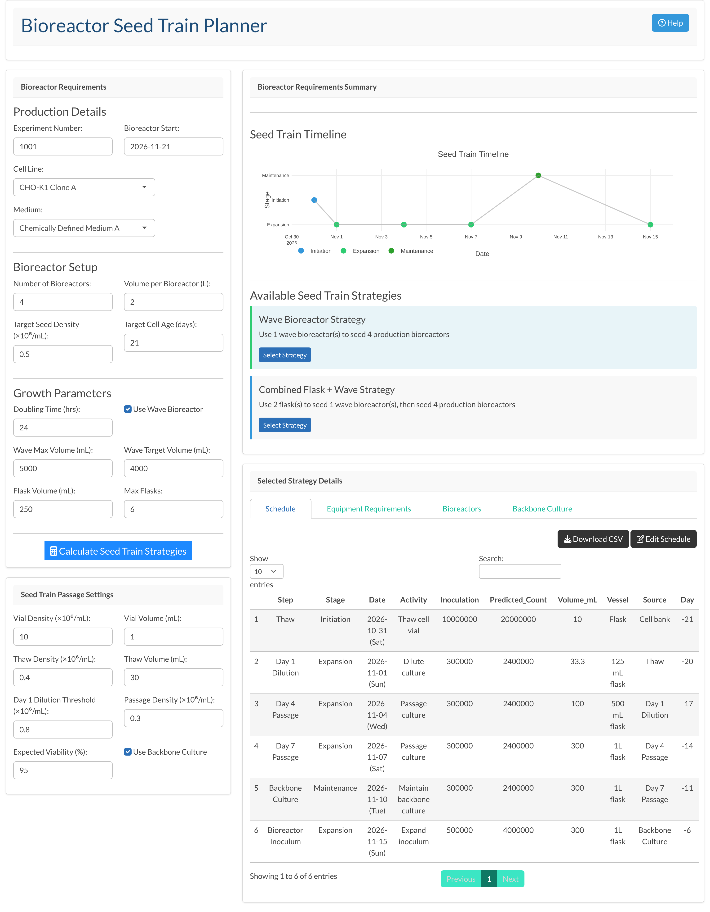

# Seed Train Planner

An interactive **R Shiny** app that plans mammalian cell culture seed trains, working backwards from a production bioreactor start date to a vial thaw date and a day-by-day passage schedule.

**[▶ Try it live on shinyapps.io](https://steven-byrne.shinyapps.io/seed-train-planner/)** (no install needed; the app may take about 20 seconds to wake up)

Planning a seed train by hand means juggling cell growth, flask and bioreactor volumes, passage densities and lab working days. This app turns those inputs into a set of feasible expansion strategies, a schedule and a timeline that a scientist can review, download and adjust.



## Features

- **Strategy calculation** – compares flask-only, wave bioreactor, combined flask + wave, and multi-stage flask expansion routes, and keeps only those that can deliver the target cell numbers within equipment limits
- **Growth modelling** – projects cell expansion from doubling time (24 h and 72 h growth factors) and target seeding density
- **Automatic vessel selection** – picks the right flask or bioreactor for each passage volume (125 mL flask through to wave and 5 L bioreactors)
- **Back-scheduled timeline** – thaw, Day 1 dilution, Day 4/Day 7 passages, backbone culture and inoculum expansion, dated from the bioreactor start and the target cell age
- **Interactive Plotly timeline** with hover details for each step
- **Schedule table** (DT) with CSV download
- **Equipment summary** – flasks and wave bioreactors required for the selected strategy

## Inputs

| Group | Parameters |
|---|---|
| Production | Experiment number, bioreactor start date, cell line, medium |
| Bioreactors | Number, working volume, target seed density, target cell age |
| Growth | Doubling time, wave bioreactor on/off, wave max/target volume, flask volume, max flasks |
| Passage | Vial density and volume, thaw density and volume, Day 1 dilution threshold, passage density, expected viability, backbone culture on/off |

All default values, cell line names and medium names are generic examples.

## Running the app

Requires R (4.1+) and the following packages:

```r
install.packages(c("shiny", "bslib", "DT", "plotly"))
```

Then from the repository folder:

```r
shiny::runApp("app.R")
```

or open `app.R` in RStudio and click **Run App**.

## How it works

1. Total cells required = bioreactor count × working volume × target seed density.
2. Expected cell yield per vessel is projected from seeding density, volume and the 72 h growth factor `2^(72 / doubling_time)`.
3. Each strategy is tested against the equipment limits (max flasks, wave volume); infeasible routes are dropped.
4. For the selected strategy, the schedule is built backwards from the bioreactor start date: the thaw is placed at the target cell age, passages use the passage density and Day 1 dilution threshold, and each step is assigned a vessel by volume.

## Tech stack

R · Shiny · bslib (Bootstrap 5) · Plotly · DT

## Roadmap

- Use the vial and thaw density settings in the schedule calculations
- Viability-adjusted growth projections
- Editable schedule with live recalculation
- Backbone culture timeline and multi-bioreactor detail views
- Unit tests for the strategy and scheduling logic (testthat)

## About

Built by **Steven Byrne**, applying programming skills from the RMIT Graduate Certificate in Data Science to the kind of seed train planning I carried out over many years in upstream cell culture process development.

This is an independent personal project. It uses generic example values only, contains no confidential information, and is not affiliated with or endorsed by any employer or equipment supplier. Product names are trademarks of their respective owners.

## Licence

MIT – see [LICENSE](LICENSE).
